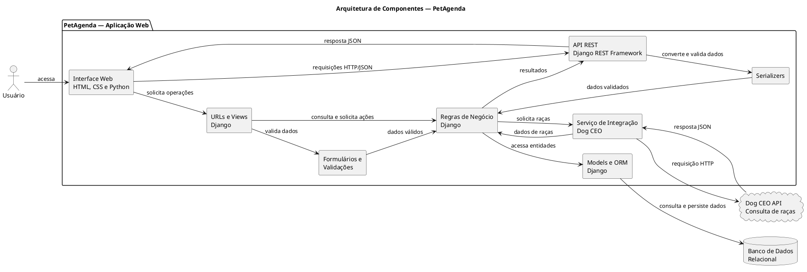

# Arquitetura da Aplicação — PetAgenda

## 1. Visão geral

O PetAgenda será uma aplicação web desenvolvida em Python com o framework Django, destinada ao gerenciamento de pets e seus atendimentos. A aplicação permitirá cadastrar, consultar, atualizar, excluir e pesquisar informações, além de consultar históricos e gerar relatórios consolidados.

A arquitetura será organizada em camadas, separando a interface do usuário, as regras de negócio, o acesso aos dados e as integrações externas. Essa separação facilita a manutenção, a realização de testes e a evolução do sistema.

A aplicação também disponibilizará uma API REST própria, desenvolvida com Django REST Framework, e consumirá a Dog CEO API para consultar raças de cães durante o cadastro de pets.

## 2. Diagrama de componentes

O diagrama abaixo representa os principais componentes da aplicação e suas integrações.



**Observação:** o código acima é a fonte editável do diagrama. Ele pode ser renderizado em uma ferramenta compatível com PlantUML e exportado em PNG, SVG ou PDF para inclusão na documentação.

## 3. Componentes e responsabilidades

| Componente | Tecnologia | Responsabilidade |
|---|---|---|
| Interface Web | HTML, CSS e Python | Apresentar as telas, formulários, listas, pesquisas e relatórios ao usuário. |
| URLs e Views | Django | Receber requisições, direcioná-las para as operações correspondentes e retornar páginas ou respostas. |
| Formulários e Validações | Django Forms e validações do Django | Validar os dados enviados pelos formulários antes de serem processados. |
| Regras de Negócio | Python e Django | Aplicar as regras relacionadas ao cadastro de pets, atendimentos e relatórios. |
| Models e ORM | Django ORM | Representar as entidades do sistema e intermediar o acesso ao banco de dados. |
| API REST | Django REST Framework | Disponibilizar os recursos do sistema por meio de endpoints HTTP. |
| Serializers | Django REST Framework | Validar e converter dados entre objetos Python e JSON. |
| Serviço de Integração | Python | Consultar a API externa, interpretar sua resposta e tratar erros de comunicação. |
| Banco de Dados | SQLite no desenvolvimento ou PostgreSQL | Armazenar os dados dos responsáveis, pets e atendimentos. |
| Dog CEO API | API REST externa | Fornecer a lista de raças de cães utilizada pela aplicação. |

## 4. Organização em camadas

### 4.1. Camada de apresentação

É a camada com a qual o usuário interage. Será composta por páginas HTML, estilos CSS e Python, utilizando os templates do Django.

Suas responsabilidades incluem:
- Exibir os pets cadastrados.
- Apresentar formulários de cadastro e edição.
- Permitir pesquisas e filtros.
- Exibir os atendimentos e seus históricos.
- Apresentar relatórios com informações consolidadas.

### 4.2. Camada de aplicação e regras de negócio

Será implementada principalmente em Python, com Django. Essa camada receberá as solicitações, coordenará as operações e aplicará as validações necessárias.

Suas responsabilidades incluem:
- Controlar as operações de cadastro, consulta, atualização e exclusão.
- Validar informações antes de persistir os dados.
- Coordenar o relacionamento entre responsáveis, pets e atendimentos.
- Preparar informações para pesquisas e relatórios.
- Coordenar a consulta à API externa quando necessária.

### 4.3. Camada de acesso a dados

Utilizará os Models e o ORM do Django para representar e acessar as entidades armazenadas no banco de dados.

As principais entidades previstas são:

- **Responsável:** informações da pessoa responsável pelo pet.
- **Pet:** informações do animal, incluindo nome, espécie, raça e responsável.
- **Atendimento:** informações sobre os serviços realizados ou agendados para um pet.

O relacionamento previsto é de um responsável para vários pets e de um pet para vários atendimentos.

### 4.4. Camada de API REST

Será implementada com Django REST Framework e permitirá que outros sistemas ou clientes compatíveis consultem e manipulem os recursos disponibilizados pelo PetAgenda.

Os endpoints iniciais previstos são:

| Método | Endpoint | Finalidade |
|---|---|---|
| GET | `/api/pets/` | Listar pets. |
| POST | `/api/pets/` | Cadastrar um pet. |
| GET | `/api/pets/<id>/` | Consultar um pet específico. |
| PUT | `/api/pets/<id>/` | Atualizar um pet. |
| DELETE | `/api/pets/<id>/` | Excluir um pet. |
| GET | `/api/atendimentos/` | Listar atendimentos. |
| POST | `/api/atendimentos/` | Cadastrar um atendimento. |

Os endpoints representam o contrato inicial e poderão ser ajustados conforme os requisitos forem detalhados. As respostas utilizarão JSON e códigos HTTP adequados à operação realizada.

### 4.5. Camada de integração externa

A integração com a Dog CEO API será realizada por um serviço específico da aplicação, responsável por enviar requisições HTTP e interpretar as respostas recebidas.

A integração será utilizada no cadastro de pets para disponibilizar uma lista de raças de cães. A raça selecionada será armazenada no cadastro do pet, evitando que o sistema dependa de uma nova consulta externa sempre que o registro for exibido.

A documentação da API está disponível em:

https://dog.ceo/dog-api/breeds-list

O endpoint de consulta da lista de raças é:

`https://dog.ceo/api/breeds/list/all`

A aplicação deverá tratar situações em que a API esteja indisponível ou retorne uma resposta inválida. Nesses casos, poderá informar o usuário e permitir o preenchimento manual da raça, sem impedir o cadastro do animal.

## 5. Fluxo de dados

### 5.1. Cadastro de um pet

1. O usuário acessa o formulário de cadastro.
2. A interface solicita à aplicação a lista de raças disponíveis.
3. O serviço de integração consulta a Dog CEO API.
4. A aplicação apresenta as opções recebidas ou permite informar a raça manualmente em caso de indisponibilidade.
5. O usuário preenche os dados e envia o formulário.
6. O Django valida as informações recebidas.
7. Os Models e o ORM persistem os dados no banco de dados.
8. A aplicação retorna uma confirmação ou apresenta os erros encontrados.

### 5.2. Consulta pela API REST própria

1. Um cliente envia uma requisição HTTP para um endpoint do PetAgenda.
2. O Django REST Framework recebe e encaminha a requisição.
3. Os serializers validam os dados, quando aplicável.
4. A aplicação executa a operação solicitada.
5. O ORM consulta ou atualiza o banco de dados.
6. O sistema retorna uma resposta JSON com os dados ou uma mensagem de erro e o código HTTP correspondente.

### 5.3. Geração de relatórios

1. O usuário seleciona os filtros desejados, como período ou tipo de atendimento.
2. A aplicação valida os filtros.
3. O Django consulta e consolida os dados armazenados.
4. Os resultados são apresentados em uma tela de relatório.
5. Conforme a implementação, o resultado poderá ser exportado ou impresso.

## 6. Tecnologias escolhidas e justificativas

| Tecnologia | Justificativa |
|---|---|
| Python | Linguagem utilizada no desenvolvimento da aplicação, com sintaxe acessível e suporte a bibliotecas web. |
| Django | Framework que oferece estrutura para rotas, views, templates, modelos, validações e migrações. |
| Django REST Framework | Facilita a criação da API REST própria e o tratamento de dados em JSON. |
| HTML, CSS e Python | Permitem construir uma interface web organizada e responsiva. |
| SQLite | Opção simples para desenvolvimento inicial e testes locais. |
| PostgreSQL | Alternativa de banco relacional para publicação e utilização em ambiente de produção. |
| Dog CEO API | Disponibiliza informações sobre raças de cães para uso no cadastro de pets. |
| Git e GitHub | Permitem versionar o código e a documentação, acompanhar alterações e identificar as contribuições dos integrantes. |
| PlantUML ou diagrams.net | Permitem elaborar e exportar os diagramas da arquitetura. |

A escolha definitiva do banco de dados de produção dependerá do ambiente de publicação. A tecnologia de interface também poderá ser ampliada conforme as necessidades do projeto.

## 7. Segurança e tratamento de erros

A arquitetura deverá considerar os seguintes cuidados:

- Validar os dados recebidos nos formulários e endpoints da API.
- Utilizar as proteções nativas do Django, incluindo proteção contra CSRF nos formulários web aplicáveis.
- Restringir operações de alteração e exclusão a usuários autorizados, conforme as regras de autenticação definidas para o projeto.
- Não armazenar senhas, chaves ou outros segredos diretamente no código ou no repositório.
- Utilizar variáveis de ambiente para configurações sensíveis.
- Tratar erros de comunicação, respostas inválidas e indisponibilidade da Dog CEO API.
- Retornar mensagens adequadas sem expor detalhes internos da aplicação.
- Realizar testes das operações de cadastro, consulta, atualização e exclusão, além das integrações.

A autenticação e as permissões específicas ainda deverão ser definidas nos requisitos do projeto antes da implementação.

## 8. Decisões e justificativas arquiteturais

A arquitetura foi definida considerando a simplicidade necessária para um projeto acadêmico e a possibilidade de expansão futura.

As principais decisões são:

1. **Utilizar Django:** centraliza a estrutura da aplicação e reduz a necessidade de implementar manualmente funcionalidades comuns de sistemas web.
2. **Separar responsabilidades:** facilita a manutenção, os testes e a identificação de erros.
3. **Utilizar banco de dados relacional:** permite representar os relacionamentos entre responsáveis, pets e atendimentos com integridade referencial.
4. **Disponibilizar uma API REST própria:** atende ao requisito de exposição de recursos por HTTP e permite integração com outros clientes.
5. **Consumir uma API externa em um fluxo real:** a consulta de raças auxilia o preenchimento do cadastro de pets.
6. **Tratar falhas externas:** a indisponibilidade da Dog CEO API não deverá comprometer o acesso aos dados já armazenados nem impedir necessariamente novos cadastros.
7. **Versionar documentação e código:** garante histórico de alterações e evidencia a participação dos integrantes.

## 9. Organização prevista dos arquivos

A documentação da arquitetura será armazenada no seguinte diretório:

```text
docs/
└── arquitetura/
    ├── arquitetura.md
    ├── arquitetura.puml
    └── arquitetura.png
```

- `arquitetura.md`: descrição das camadas, componentes, tecnologias e decisões.
- `arquitetura.puml`: código-fonte editável do diagrama PlantUML.
- `arquitetura.png`: exportação do diagrama para consulta rápida.

O conteúdo deverá ser revisado em conjunto com o documento de visão, os casos de uso, o modelo de dados e o contrato da API, garantindo que todos representem as mesmas funcionalidades e entidades.

## 10. Status da arquitetura

Esta arquitetura representa a proposta inicial do PetAgenda para a Fase 1. Os componentes e fluxos serão confirmados durante a implementação, podendo sofrer ajustes justificados conforme os requisitos forem detalhados e os testes forem realizados.
